Simplified Chinese | [English](UI_PLUGIN.en.md)

从 Excalidraw Start了解 UI Plugin：让 Agent andUser共同EditOne份可Save的inner容。本Text覆盖Current源码Medium的Capabilities、实际Available的 API、Install调试Steps与五个Example，优先按下面的路线阅读。

- [先看 Excalidraw Demo](#重点Exampleexcalidraw)
- [Gen UI：Example、接口与适用场景](#gen-ui按需生成可交互的Answer)
- [开发与调试](#开发与调试)
- [Pages API 速查](#Pages-api-速查)
- [To自己的Plugins接入 UI](#To自己的Plugins接入-ui)
- [OtherExample](#OtherSample plugin)

本篇面向主仓库的宿主联调；Plugins开发与构建在独立的 `cf-plugins` 仓库Completed。

UI Plugin To普通Plugins增加可交互Pages。Agent 可以Call tool创建or修改inner容，User可以直接操作画布、表单、Filelist，再把选区or操作Result交回Chat。PagesPassed MCP Apps 与宿主通Letter，业务Data由Plugins的 MCP ServiceManage。

注册、Install、Enableand更New沿用普通Plugins流程。Pages使用Official `@modelcontextprotocol/ext-apps`，不需要单独的 CodeFusion Plugin SDK，也不要求Install开发Point to引Plugins。CurrentPlugins仓库锁定Pages SDK `2.0.0`、MCP Service SDK `1.29.0`；阅读上游Example时注意 SDK 主Version，实际Install以仓库锁File为准。

| Capabilities               | User看到的效果                               | 开发入口                                         |
| ------------------ | -------------------------------------------- | ------------------------------------------------ |
| Tool Result带交互Pages | 生成画板、展示图表、填写表单                 | MCP Tools `_meta.ui.resourceUri` + HTML 资源      |
| SessionSidebar面板       | 手动打开Editor，后续ToolsContinue操作同One份Documentation   | 清单 `ui.surfaces`，Tools `_meta.ui.surface`      |
| Pages调用PluginsService   | 点击按钮RefreshData、SaveDocumentation、execute操作         | `app.callServerTool()`                           |
| Pages与主Chat协作   | 引用选区，or由User点击SendNextMessages         | `updateModelContext()` / `sendMessage()`         |
| App innerModel调用     | Answer留在Plugins自己的Boundary面                       | `createSamplingMessage()`                        |
| Model调用PagesTools   | 操作只有活Pages才拥有的EditorStatus             | `registerTool()` or `onlisttools` + `oncalltool` |
| PagesStatus与资源更New | 切换LocationRetainPages，重建恢复View，订阅Service变化 | 活PagesRetain、widgetState、资源订阅                |

交互Pages目前用于 **CodeFusion Desktop 的LocalWorkspace**。Web、手机andRemoteWorkspaceRetain普通 MCP Tools记录，不把这些路径视为已经支持交互面板。PluginsPages与 Gen UI 的加载and通LetterProtocol不同，不能混用两者的 API。

Excalidraw 展示的YesOne套可Continue editing的绘图Workflow：Agent 画初稿，User调整布局，再让 Agent 按选区做局部修改。画布不YesOne次性Image。

下面用微分方程学习场景展示Complete流程：生成画布、引用选区，再带着ContextContinueAsk。

**1. 从One个Issue生成可Edit画布**

Request“画One个微分方程，我在学习，让我Fast能理解”，Agent kConcepts、解题Stepsand斜率场绘制到 Excalidraw 画布。ChatMedium的解释andSidebarMedium的画布并排展示，图形与TextCharacterCan continueEdit，也可以Save、导出。

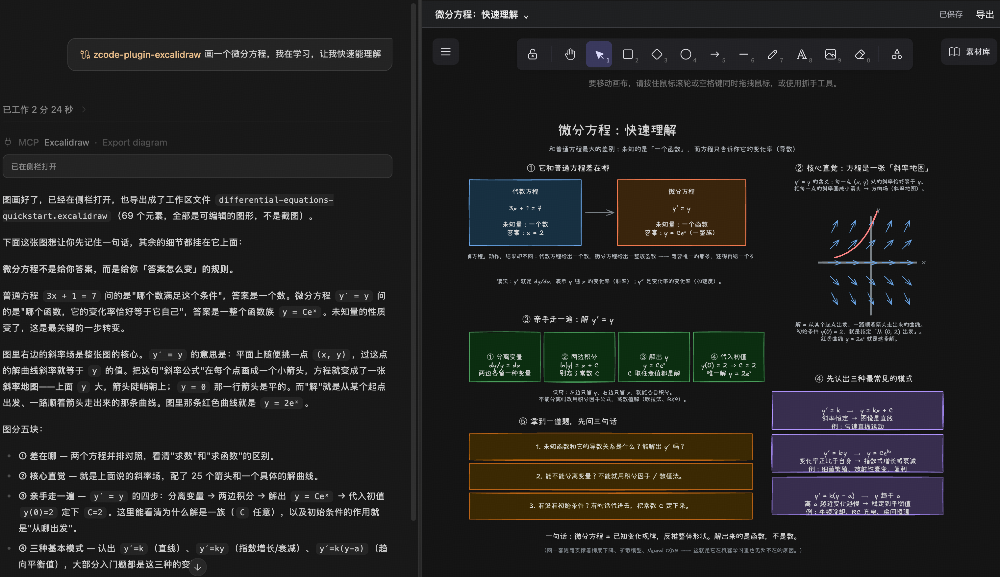

**2. 引用选区，把关注点交To Agent**

框选“斜率地图”这One组元素，Right键选择 **引用选区到Chat**。Plugins把选Medium元素的Letter息加入ChatContext，User可以针对图Medium的某One部分Continue交流。

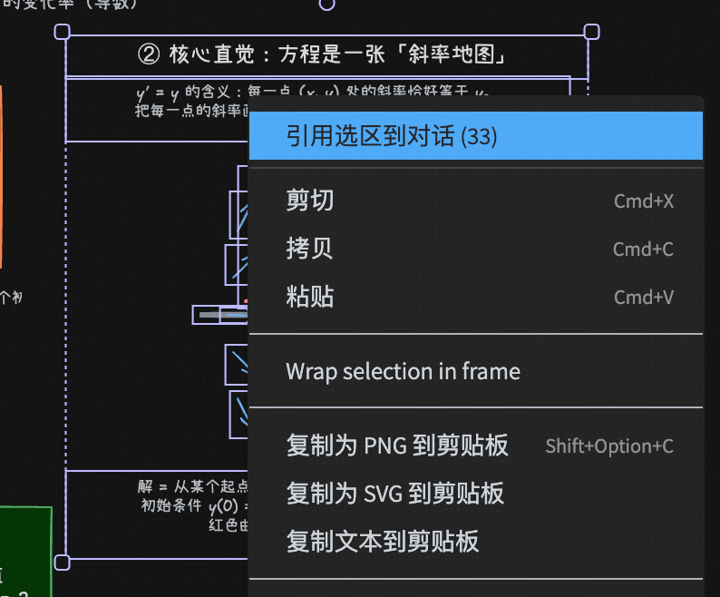

**3. 带着选区ContinueAsk**

Input区出现 **PluginsContext** 后，Supplement“箭头方向YesPoint to什么？”，再点击Send。引用选区会先Add待Send的Context；SendIssue时，Agent 才会收到Issueand选区Letter息，理解UserQuestion的Yes画布Medium的哪One部分。

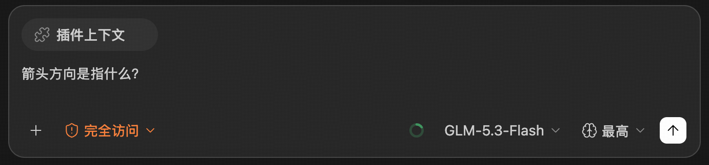

Install并Enable `excalidraw` 后，在One个DesktopLocalWorkspace的NewSession里依次操作：

1. Send：“用 Excalidraw 画One个 API、CacheandData库的架构图，Label出Request方向。”Model调用 `create_diagram`，Sidebar打开可Edit画板。
2. 拖动节点、改颜色orTextCharacter，WaitingPagesShow“已Save”。这表示Backend已确认Save。
3. 选Medium“Cache”节点，Right键选择“引用选区到Chat”；Send：“把选Medium的Cache改成双节点，RetainOther布局。”未选Medium元素时也可以引用整图。
4. Agent 用 `read_scene` Read最NewVersion，再用稳定元素 ID execute `apply_operations`，无需重画整个画布。UserEditandToolsEdit共用CurrentPages的Undo/Redo。
5. 点击画板Title切换or导入Documentation；Passed“导出”Save `.excalidraw`、PNG、SVG 到Workspace，覆盖已有File需要明确选择覆盖。

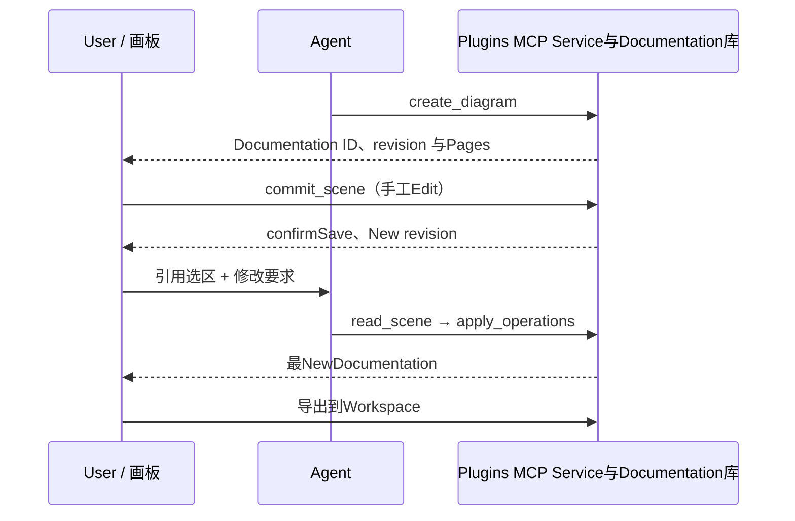

下面YesPlugins自己的 MCP Tools，and后Text的通用Pages API Yes两个层次。“仅Pages”Tools不会暴露到ModelToolslist。

| Tools               | 调用方     | 用途与关键参Count                                                       |
| ------------------ | ---------- | -------------------------------------------------------------------- |
| `create_diagram`   | Model、Pages | 用 `title`、`elements` New画板；BackDocumentation ID andVersion                  |
| `open_diagram`     | Model、Pages | 用 `id` 打开已SaveDocumentation，or用 `path` 导入Workspace `.excalidraw`；Two选One |
| `read_scene`       | Model、Pages | ReadCurrentVersionand元素Summary；Available `elementIds` 限定选区                   |
| `apply_operations` | Model、Pages | 按元素 ID 增、改、删；携带 `expectedRevision` 与 `operationId`       |
| `export_diagram`   | Model、Pages | 导出原生 `.excalidraw`；CheckVersion，覆盖需 `overwrite: true`           |
| `commit_scene`     | 仅Pages     | SubmitCompleteEditDraft，executeVersion冲突Check                                   |
| `list_diagrams`    | 仅Pages     | 列出Current workspaceDocumentation                                                   |
| `save_copy`        | 仅Pages     | kDraftor导入inner容另存为NewDocumentation                                         |
| `save_image`       | 仅Pages     | kPages渲染的 PNG / SVG WriteWorkspace                                    |

业务Documentation在PluginsDataTable of Contentsinner以 SQLite Save，按Workspace Isolation。Version冲突会Retain本页Draft，可另存Replicaor重载；E同操作Retry复用 `operationId`。`widgetState` 只SaveViewLetter息，不能代替Documentation库。

Current每份Documentation最多 5000 个元素、6 MiB。EditorandFont随包提供，不依赖 CDN。Undo历史只属于Current活Editor，不跨应用重启Save；Current未提供多人实时协作、System剪贴板Permissionsor云分享。

Gen UI（生成式Boundary面）让 Agent 针对CurrentIssue生成 HTML / JavaScript Pages，直接嵌入Chat。你可以拖动滑块、切换条件、勾选Project，观察Result，再带着Current参CountContinueAsk。每个Pages按需生成，无需先为它创建andInstallPlugins。

下面YesOne组按需生成的CapabilitiesDemoPages。groupingandinner容展示了Pages可以如何组织，不Yes应用里的固定Boundary面。点击Image可View原图。

| 组件与Letter息组织                                                                                                                                                       | 控件驱动计算                                                                                                                                               |
| -------------------------------------------------------------------------------------------------------------------------------------------------------------------- | ---------------------------------------------------------------------------------------------------------------------------------------------------------- |
| <a href="docs/images/gen-ui/components.png">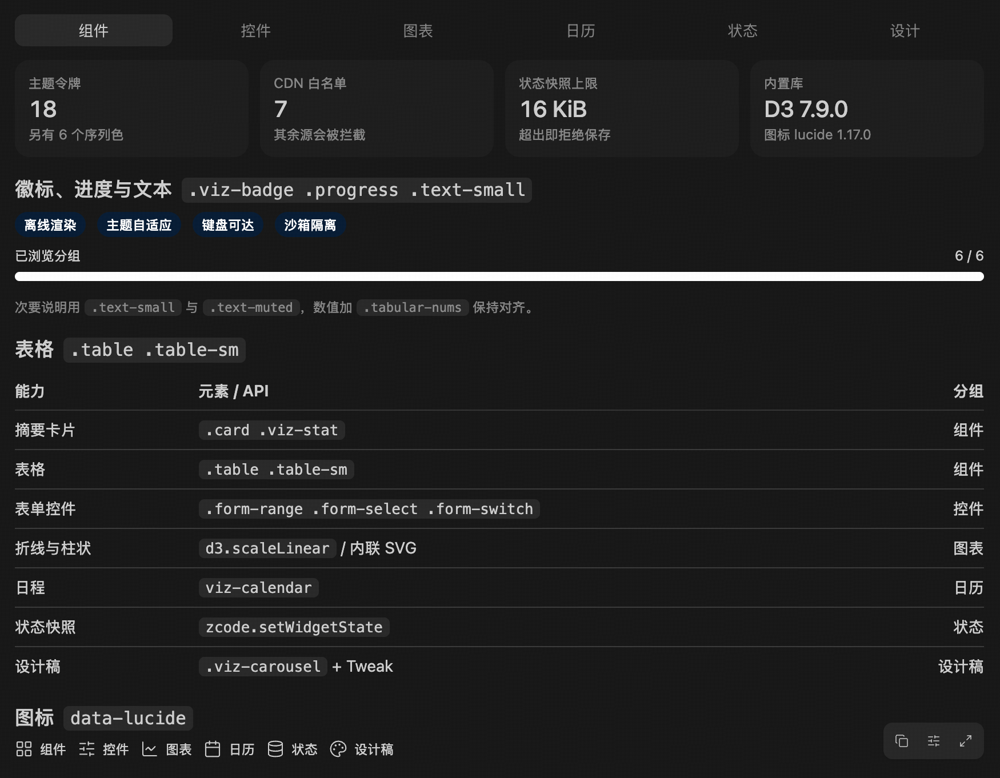</a> | <a href="docs/images/gen-ui/controls.png">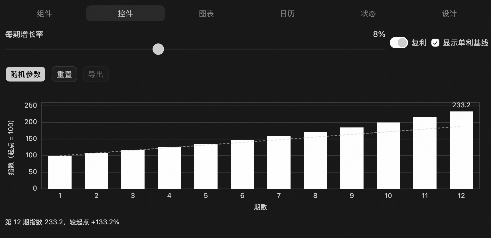</a> |
| 用Summary卡片、进度条、表格and图Label，把Answer组织成可浏览的面板。                                                                                                           | Passed增Long率滑块、复利开关and基线选项，对比不同参Count下的计算Result。                                                                                             |

| 图表与Data对比                                                                                                                                                         | Calendar与日程                                                                                                                                                   |
| ---------------------------------------------------------------------------------------------------------------------------------------------------------------------- | ------------------------------------------------------------------------------------------------------------------------------------------------------------ |
| <a href="docs/images/gen-ui/charts.png">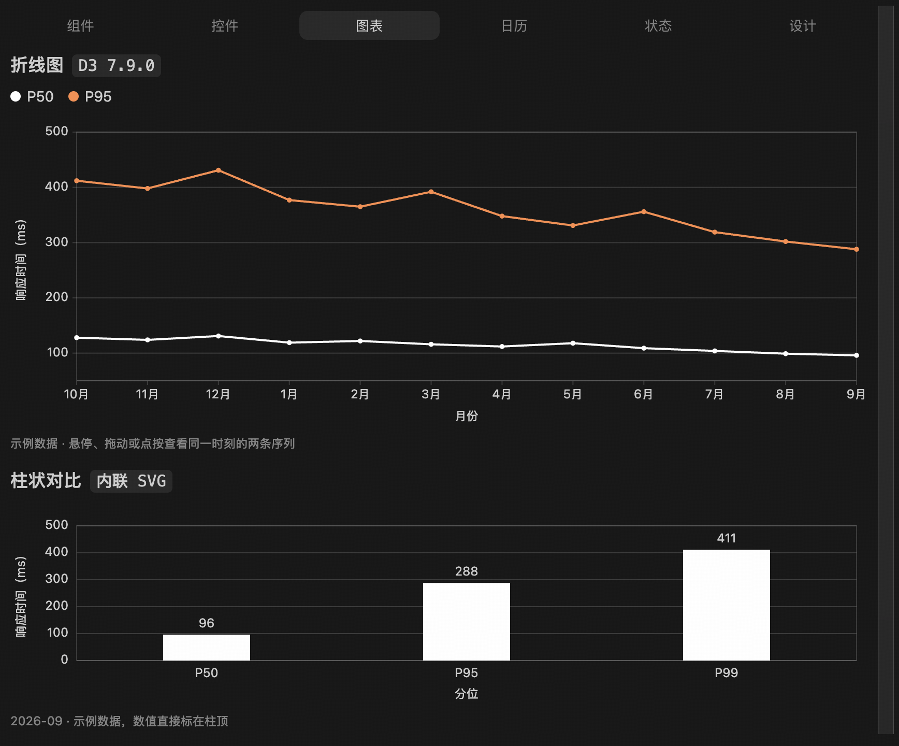</a> | <a href="docs/images/gen-ui/calendar.png">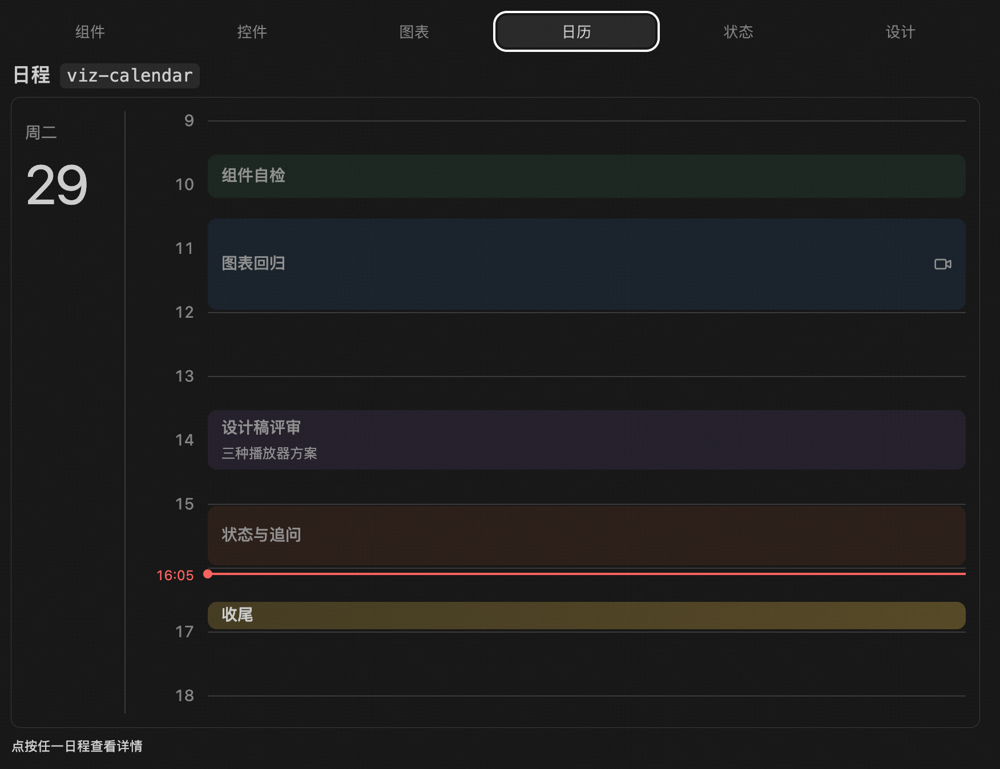</a> |
| 折线图对比 P50 / P95 趋势，柱状图展示各分位；图Medium为ExampleData。                                                                                                          | `viz-calendar` 按时间段展示日程，并支持ViewEventsDetails；这里YesPagesinner的日程Demo。                                                                                |

| StatusSave与追Question                                                                                                                                                                 | Design预览与调整                                                                                                                                                   |
| ------------------------------------------------------------------------------------------------------------------------------------------------------------------------------ | ---------------------------------------------------------------------------------------------------------------------------------------------------------------- |
| <a href="docs/images/gen-ui/state.png">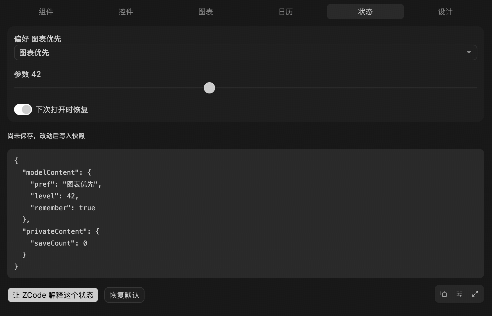</a> | <a href="docs/images/gen-ui/design.png">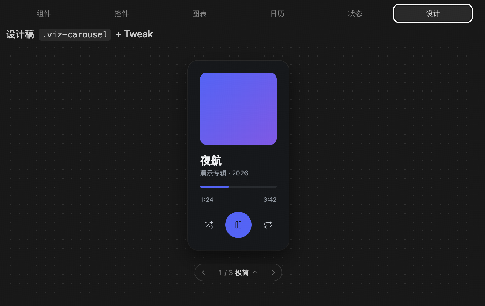</a> |
| k偏OKand参Array织成 `modelContent` / `privateContent` 快照。画面展示待SaveStatus；Pages可Save参Count，再Passed按钮发From追Question。                                                            | `viz-carousel` 展示多种播放器Design，配合 Tweak 调整样式；This isBoundary面原型。                                                                                           |

在支持 Gen UI 的 CodeFusion Desktop SessionMedium，可以直接提出下面这样的Request。具体控件and交互由 Agent 根据Task生成：

| 场景         | ExamplePrompt                                                                                    | 可以如何交互                                  |
| ------------ | --------------------------------------------------------------------------------------------- | --------------------------------------------- |
| 理解Concepts     | “用 Gen UI 解释正弦波，让我拖动滑块调整振幅and频率，观察曲线变化。”                            | 调整参Count、比较曲线，理解变量之间的关系        |
| exploreAlgorithm     | “用 Gen UI 做One个Two分FindDemo，能InputTargetValue、单步execute，并Label出CurrentSearch区间。”                  | 修改Input、前进andReset，观察每One步的Status        |
| 调整Boundary面Option | “用 Gen UI 做One张Course卡片，提供 Tweak 控件调整圆角、配色and布局密度，再按我选的参CountContinue完善。” | 即时预览样式，明确Submit调整后让 Agent Continue修改 |

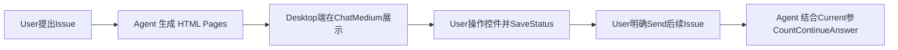

| Capabilities       | Current行为                                                                                   |
| ---------- | ------------------------------------------------------------------------------------------ |
| Chatinner交互 | Pages随AnswerCompleted后展示，可包含图表、表单、模拟器and轻量原型                                   |
| 展开与分享 | 可以展开预览、Collapse，并CopyCurrentBoundary面为Image；展开andCollapseRetain同One个活Pages                       |
| Status与追Question | Pages可Save控件Status，并在User触发后Send后续Issue；仅调整控件orSaveStatus不会AutoStart Agent     |
| Tweak 调整 | Pages注册控件后，宿主提供滑块、颜色、开关and选项等调整入口，支持Reset、Raw效果预览and明确Submit |

生成Pages使用宿主注入的 Gen UI 接口：

| 接口                                                            | 用途                                                                                  |
| --------------------------------------------------------------- | ------------------------------------------------------------------------------------- |
| `window.cf.widgetState`                                      | Read已Save的PagesStatus，初始Value可能为 `null`                                             |
| `window.cf.setWidgetState({ modelContent, privateContent })` | 替换整个 JSON Status快照，合计不超过 16 KiB；只有 `modelContent` 会进入下One轮ModelContext |
| `window.cf.sendFollowUpMessage({ prompt, title })`           | Send后续Issue，`title` Optional；没有有效User操作时Confirmation required，Invalidor只读Session不能Send        |
| `cf:set_globals`                                             | 监听StatusorTheme更New，从Events的 `detail.globals` ReadNewValue                                |

Desktop端会向 Agent 提供CurrentSession的专用OutputTable of Contents。生成的 HTML Save在该Table of Contents，由宿主加载，不WriteProjectWorkspace；PagesStatus按WorkspaceandSession isolation。Pages桥接由宿主注入，作者不用再创建 MCP Apps Connect。Gen UI Pages不提供 `callTool`、MCP 资源Read、Node or任意File访Question；需要PluginsServiceexecute操作时使用 UI Plugin。

| 对比项   | Gen UI                                           | UI Plugin                                           |
| -------- | ------------------------------------------------ | --------------------------------------------------- |
| Source     | Agent 围绕CurrentIssue即时生成Pages                   | 开发者维护andPublishPlugins，UserInstall、Enable                |
| 适合什么 | Concepts讲解、交互图表、模拟器、临时计算器andBoundary面原型 | 持续使用的Editor、FileToolsand带业务Data的应用        |
| PagesCapabilities | Gen UI Status、追Question与 Tweak 接口                   | MCP Apps API、Plugins MCP Tools与资源，遵循宿主支持范围 |
| Data归属 | 宿主Manage生成FileandSessionPagesStatus                   | PluginsServiceManage业务FileorData库，PagesManageView          |

上面的 Excalidraw Screenshot展示的Yes **UI Plugin**。如果需要按CurrentIssue生成One个可调参Count的小Pages，使用 **Gen UI**；如果要分发One个Long期使用、带ServiceandDocumentationManage的Tools，开发 UI Plugin。两者虽都可能出现 `window.cf`，Available方法andStatusStructures不同，不能混用。UI Plugin 的开发与 API 见[开发与调试](#开发与调试)and[Pages API 速查](#Pages-api-速查)。

Implementation与PagesExample：[Gen UI 契About](packages/ui/src/gen-ui/CONTRACT.md)、[Pages API Example](apps/cli/packages/visualize-plugin/skills/visualize/references/api.md)、[Tweak Point to南](apps/cli/packages/visualize-plugin/skills/visualize/tweak.md)。Desktop集成验证入口为 `node packages/desktop/scripts/gen-ui-e2e.mjs`。

| Plugins                          | 功能与DemoPoint to令                                     | 适合参考什么                                                     | CurrentBoundaries                                                                            |
| ----------------------------- | -------------------------------------------------- | ---------------------------------------------------------------- | ----------------------------------------------------------------------------------- |
| **Excalidraw** `excalidraw`   | “画One张System架构图，再按选区修改”                   | 画布、AutoSave、局部Edit、Context引用and导出，建议作为首个CompleteExample | LocalWorkspace；持久Documentation与临时View分开                                                  |
| **OpenPencil** `openpencil`   | “NewDesign稿 designs/landing.fig，放One个 hero 区块” | `.fig` Design稿、DesignTools、选区引用与按稿生成代码                  | One个WorkspaceOne个活Editor；`.pen` 只读导入；导出到 `exports/`                          |
| **Blender** `blender`         | “NewOne个 Blender 场景，放置物体并渲染预览”        | `.blend` 场景、3D 预览、材质、E机、灯光and渲染资源               | 真实操作需要 Blender 引擎；假引擎仅用于Tests                                         |
| **磁盘清理器** `disk-cleaner` | “看看下载Table of Contents里哪些大File占空间”                   | 只读扫描、分页筛选、候选选择、确认Plan与executeFeedback                 | 清理Tools仅供Pages使用；确认后移入回收站，不提供永久Delete                              |
| **Showcase** `showcase`       | “用 Showcase DemoAll case”                        | SC01–SC53 Table of Contents；资源、Messages、Status、sampling、PagesToolsandFailed场景   | Table of Contents项分直接操作、配合操作、Automation专用、待Implementation；53 项不代表 53 项都已ImplementationorAuto验收 |

| 仓库地址                                                          | 分支             | 修改范围                                       | RunLocation                                                |
| ----------------------------------------------------------------- | ---------------- | ---------------------------------------------- | ------------------------------------------------------- |
| [zai-org/CodeFusion](https://github.com/zai-org/CodeFusion)                 | `feat/ui-plugin` | 宿主Protocol、Sidebarandinner联展示、沙箱、审批与Lifecycle | `pnpm dev:desktop`                                      |
| [zai-org/cf-plugins](https://github.com/zai-org/cf-plugins) | `feat/ui-plugin` | Plugins清单、MCP Service、Pages、业务Data与资源打包   | `ui-plugins/<name>` 为源码；`plugins/<name>` 为Install产物 |

本Text的开发与调试Steps对应两个仓库各自的 `feat/ui-plugin` 分支。**CodeFusion 公开仓库的该分支目前尚未建OK**，待分支Preparation就绪后再从上述仓库检出并联调。

以下 shell Example适用于 macOS / Linux，先把两个路径改为自己的检出Table of Contents。Node.js 使用 `24.14.0`，pnpm 使用 `10.33.2`。Windows 可在 PowerShell MediumSettingsE同环Context变量，再execute各仓库的 `pnpm` / `node` Command。

```sh
CF_REPO=/path/to/z-code
PLUGINS_REPO=/path/to/cf-plugins

export CF_DATA_BASE_DIR="$HOME/.cf-ui-plugin-dev"

cd "$CF_REPO"
pnpm bootstrap

cd "$PLUGINS_REPO"
pnpm install --frozen-lockfile
pnpm build

cd "$CF_REPO"
node apps/cli/packages/cli/dist/cf.cjs plugins marketplace add "$PLUGINS_REPO/dist/local-marketplace" --scope user
node apps/cli/packages/cli/dist/cf.cjs plugins install excalidraw@cf-plugins-local --scope user
node apps/cli/packages/cli/dist/cf.cjs plugins enable excalidraw@cf-plugins-local --scope user
node apps/cli/packages/cli/dist/cf.cjs plugins list --json
pnpm dev:desktop
```

也可以在同OneDesktopInstance的 **Plugin Marketplace → New增** MediumAdd `dist/local-marketplace` 的绝对路径，再选PluginsInstallandEnable。DefaultLocalSource名Yes `cf-plugins-local`；根清单的OfficialNameYesRetainName，不能直接Add仓库根Table of Contents。`pnpm dev:desktop` 只Start宿主，不Auto注册Plugins。

如只用现成DesktopCustomer端，在Plugins仓库构建后走上述 UI Install即可；Customer端本身需要支持本Text功能。使用已Install的 `cf` CLI 时，确认它andDesktop使用同One个DataConfiguration。首次使用IsolatedConfiguration时，也需在该ConfigurationMediumCompleted登录orModel Settings。

```sh
cd "$PLUGINS_REPO"
pnpm build
cd "$CF_REPO"
node apps/cli/packages/cli/dist/cf.cjs plugins marketplace update cf-plugins-local
node apps/cli/packages/cli/dist/cf.cjs plugins install excalidraw@cf-plugins-local --scope user
```

随后重启对应DesktopInstance，打开NewSession验证。源码监听不会把Plugins仓库的修改AutoCopy到已InstallPlugins；RefreshSource只RefreshTable of Contents，重NewInstall才更New代码Replica。开发时同Version重装会重NewCopy；Formal分发inner容变化仍需UpgradePlugins清单、marketplace and源码包Version。

已有OtherLocalSourceName时，用 `pnpm marketplace:local --name my-local-plugins --output dist/my-local-plugins` 保持原身份，CommandMedium的市场名也随之调整。不要为了更New同One个LocalSource重复创建多个Install身份。`python3 scripts/build_dist.py` 会Clear根 `dist/`，之后可execute `pnpm marketplace:local` 重建LocalTable of Contents。

| 层次                        | 在哪里Run | Command                                                         | 能证明什么                                                            |
| --------------------------- | ---------- | ------------------------------------------------------------ | --------------------------------------------------------------------- |
| Plugins静态Check                | Plugins仓库   | `pnpm typecheck`、`pnpm lint`、`python3 scripts/validate.py` | 类型、代码规则and清单One致性                                            |
| 通Letter与业务单测              | Plugins仓库   | `pnpm test`                                                  | Connect顺序、Version冲突、Cancel等Automation回归                                  |
| 独立Install产物                | Plugins仓库   | `pnpm test:artifacts`                                        | 从仓库outerStart构建产物、Read page/资源，CheckRun依赖                     |
| Official App/AppBridge Pages通Letter | Plugins仓库   | `pnpm test:pages`                                            | Blender、Excalidraw、OpenPencil 的真实 SDK 握手、初始Result、ThemeandCancel |
| Excalidraw 冒烟             | Plugins仓库   | `pnpm --filter @origin-ai/cf-plugin-excalidraw smoke`               | 实际 stdio Service与资源接口                                             |
| Excalidraw Browser交互       | Plugins仓库   | `pnpm --filter @origin-ai/cf-plugin-excalidraw test:e2e`            | 真实画布交互、Save、Undo/Redoand冷Start；Tests宿主桥不等于 Electron 沙箱 |
| Showcase Desktop联调           | 主仓库     | 下方 `--showcase-only` Command                                  | Current源码的 Agent、沙箱、真实Pages与Session通Letter                            |

TestsPages前先 `pnpm build`；BrowserTests需要 Chrome，orPassed `CHROME_PATH` Point to定 Chromium。Excalidraw BrowserScreenshotDefault在System temporary directory的 `excalidraw-e2e`，Available `EXCALIDRAW_E2E_ARTIFACTS` Point to定Output路径。

```sh
cd "$CF_REPO"
CF_SHOWCASE_SERVER="$PLUGINS_REPO/plugins/showcase/dist/server.mjs" \
  node packages/desktop/scripts/mcp-apps-host-e2e.mjs --showcase-only
```

Desktop fixture 使用临时 profile 与LocalModel fixture，末尾OutputResultTable of Contents。容量/回收、稳定Storage、sampling 可分别Run同脚本的 `--retention-only`、`--storage-only`、`--sampling-only`。Run这些Tests不会替代具体Plugins的真实SystemPermissions、真实 Blender 引擎or跨平台验证。

| 现e                        | 先Check                                                                                                                           |
| --------------------------- | -------------------------------------------------------------------------------------------------------------------------------- |
| Plugin Marketplace找不到Plugins          | `plugins marketplace list --json` MediumYes否有生成的LocalSource；Yes否把仓库根Table of Contents误当Tests源；CLI 与DesktopConfigurationYes否One致                     |
| 已登记Source，Sidebar仍没有面板  | `plugins list --json` 的Install/EnableStatus；CurrentYes否YesDesktopLocalWorkspace；清单的 `ui.surfaces` Yes否引用正确 `mcpServers` 键and `ui://` URI |
| 修改代码后还YesOldPages        | Yes否execute根 `pnpm build`、Refresh同OneSource并重装TargetPlugins；Yes否仍RunOldInstanceorOldSession                                                    |
| 面板打开但资源Failed          | InstallTable of ContentsYes否有 `dist`、OfflineFont/脚本/WASM；用 `test:artifacts` 排除Workspace依赖；Check CSP 与资源Read上限                           |
| 握手两次or初始画布为空      | Yes否创建了两个 App，orOfficial App 与 `window.cf` 混用；Yes否在Connect前InstallEventsProcessing器并Retain初始Result                                  |
| 点击“引用”没有立刻发Messages    | `updateModelContext` YesTo下One轮AddContext，发Messages用 `sendMessage`；CheckInput区的PluginsContext                                        |
| sampling Unavailableor参Count被Deny | Check宿主Yes否声明 `sampling`，Current taskYes否可操作，以及参CountYes否属于本Text支持子集                                                    |
| Rename后出现两份Install          | Plugins ID Modified变，OldNameandNew nameYes独立Install；按需ProcessingOldInstall，先RetainData，不直接DeletePluginsDataTable of Contents                                     |
| 开发者Tools没有PagesLogs      | 应用“Help → 开发者Tools”首先Check宿主Error；Plugins有独立 guest，优先用 `app.sendLog()` andPagesTests采集自己的Logs                       |

stdio MCP Service的 stdout 只OutputProtocolMessages，调试Logs写 stderr。定位时同时记录Plugins ID、Source名、Workspace、资源 URI and复现Steps，不记录凭据orCompleteUserDocumentation。

**向 `cf-plugins` Submit PR 时，必须在 PR TemplateMedium明确声明Plugins类型，并填写涉及Plugins的清单 `name`，再发From评审。** 选择且只选择One项：

| 选项                  | 判断Label准                                                                                    |
| --------------------- | ------------------------------------------------------------------------------------------- |
| **UI Plugin**         | 涉及的Plugins提供 MCP Apps 交互Pages，包括 `ui.surfaces` 面板andTools `_meta.ui.resourceUri` Pages |
| **普通Plugins（非 UI）** | Plugins不提供 MCP Apps 交互Pages；仅有 MCP Toolsor生成 Gen UI 的 skill 不算 UI Plugin            |
| **不适用**            | 仅仓库级Documentation、构建or CI 改动，不涉及可InstallPluginsinner容                                          |

即使只改 UI Plugin 的Documentationor skill，or者New增、移除交互Pages，也选择 UI Plugin。涉及多个Plugins时分别列出Name与类型，只要包含 UI Plugin 就选择此项。This is PR Medium的类型声明，与市场 `category` 分类独立；评审者Approve前必须确认填写Complete且准确。

沿用普通Plugins的InstallTable of Contents与市场条目；需要编译的源码包声明自己的 `build`，额outer资源使用Optional `stage`。下面YesInstall清单 `.cf-plugin/plugin.json` 的最小PagesExample：

```json
{
  "name": "my-panel",
  "version": "0.1.0",
  "description": "我的交互面板",
  "mcpServers": {
    "app": {
      "type": "stdio",
      "command": "node",
      "args": ["${CF_PLUGIN_ROOT}/dist/server.mjs"],
      "cwd": "${CF_PROJECT_DIR}",
      "env": {
        "CF_WORKSPACE_ROOT": "${CF_PROJECT_DIR}",
        "CF_PLUGIN_DATA": "${CF_PLUGIN_DATA}"
      }
    }
  },
  "ui": {
    "surfaces": [
      {
        "id": "editor",
        "title": { "en": "编辑器", "zh-CN": "Editor" },
        "server": "app",
        "resourceUri": "ui://my-panel/editor.html",
        "availability": "session"
      }
    ]
  }
}
```

Service端需要实际注册 `ui://my-panel/editor.html` 资源并Back `text/html;profile=mcp-app`。让Tool Result使用该面板时，在Tools定义MediumSettings `_meta.ui.resourceUri` and `_meta.ui.surface: "editor"`；`_meta.ui.visibility: ["model", "app"]` AllowModel与Pages调用，仅PagesTools使用 `["app"]`。`ui.surfaces` 可省Omitted，此时仍可PassedToolsMetadata提供inner联Pages。

PluginsFile使用 `${CF_PLUGIN_ROOT}` 定位，WorkspaceFile操作使用 `${CF_PROJECT_DIR}`，持久Data使用 `${CF_PLUGIN_DATA}`。UserConfigurationPassed清单 `userConfig` 定义，并在ServiceConfiguration里用 `${user_config.<key>}` 引用。PagesPassedServiceexecuteFile操作，不直接访Question主应用源码or Node API。

以Current宿主Implementationand锁定的 SDK 类型为准。先注册Events，再 `connect()`；Connect后Read `getHostCapabilities()`，按Back的CapabilitiesEnable功能。Official API Documentation描述 SDK 的Complete表面，宿主支持范围还要看下表。

| API / Events                                                      | 用途                                 | CodeFusion 行为与注意事项                                                                          |
| --------------------------------------------------------------- | ------------------------------------ | --------------------------------------------------------------------------------------------- |
| `new App(info, capabilities, options)`、`connect()`             | 创建PagesConnect并Completed握手               | 每个活Pages只建One个 App；不要同时访Question会触发另OneConnect的 `window.cf`                           |
| `getHostVersion()`、`getHostCapabilities()`、`getHostContext()` | Read宿主、Capabilities、Theme、语言and展示Mode | 在ConnectCompleted后使用；不要只按宿主VersionNumber猜Capabilities                                                    |
| `ontoolinput`、`ontoolresult`、`ontoolcancelled`                | 接收CompleteInput、ResultandCancel             | 大 UI 延迟加载时，Retain初始Result再交To UI，避免丢通知                                           |
| `onhostcontextchanged`                                          | 响应Theme、语言、尺寸orMode变化       | 更NewShow；不要因此重复execute业务操作                                                            |
| `callServerTool({ name, arguments }, options)`                  | 调用CurrentPluginsService的Tools               | 沿用 Agent 的Permissionsand审批；`options.signal` 可Cancel；Back真实 `CallToolResult`                   |
| `readServerResource({ uri })`                                   | ReadCurrentService的资源                   | Back MCP `contents`；Two进制Yes base64；不能用它访QuestionOtherPluginsor任意LocalFile                      |
| `listServerResources({ cursor })`                               | 分页列出Service资源                     | 资源Templatelist用后表Medium的 `resources/templates/list` Request                                        |
| `sendMessage({ role: "user", content })`                        | 发出主Chat后续Messages                   | 需要 `message` Capabilities；有User手势时Send，无手势时进入确认流程                                   |
| `updateModelContext({ content, structuredContent })`            | To下One轮Chat附加选区等Context         | 需要 `updateModelContext` Capabilities；在Input区可见、可删，不立即发Messages，不Yes持久Storage                |
| `createSamplingMessage(params, { signal })`                     | App inner调用Current taskModel               | 需要 `sampling` Capabilities；支持Text与符合限制的ImageInput，BackText；Chat历史由 App 提供             |
| `registerTool(name, config, handler)`                           | Pages提供可被Model调用的Tools           | 握手前登记；声明 App 的 `tools` Capabilities；随活Pages登记/Undo并遵守既有审批                         |
| `onlisttools`、`oncalltool`、`sendToolListChanged()`            | 手动ManagePagesToolsTable of Contents                 | Yes另One种PagesToolsImplementation方式；CancelLetterNumber在回调 `extra.mcpReq?.signal` Medium；Showcase 提供Complete例子     |
| `requestDisplayMode({ mode })`                                  | Request切换展示Location                     | `inline` 为inner联，`fullscreen` 为Sidebar；以BackMode为准；`pip` Current保持原Mode                    |
| `sendSizeChanged({ height })`                                   | Reportinner容High度                         | Available SDK Auto测量；手动测量inner容容器，避免把视口High度FeedbackTo宿主                                 |
| `openLink({ url })`                                             | Passed宿主打开outer链                     | 仅Allow `http:` / `https:`                                                                     |
| `downloadFile({ contents })`                                    | 调用原生SaveChat框                   | 需要 `downloadFile` Capabilities；支持嵌入资源orCurrentService的资源链接；Cancel/Write failedBack `isError: true` |
| `sendLog({ level, data })`                                      | Send可观察的PagesDiagnostics                 | 不向 stdio Service的 stdout 写调试Logs；不要记录密钥orUserinner容                                   |
| `onteardown`                                                    | 释放Pages监听器等资源                 | 宿主做有时限的 teardown，不应把唯OneSave操作留到此时                                           |
| `requestTeardown()`                                             | Request宿主释放Pages                     | Current CodeFusion 只记录Request；实际LifecycleFollow卡片/面板，不能把它当Close按钮                          |

Sampling 使用接纳Request时的TaskModel，不Read主聊天历史；只有 App 明确传入的历史进入Request。Current不接受 `temperature`、`tools`、原生 audio 等未Implementation参Count，`includeContext` 只支持 `none`。AnswerandCancel不应被AutoAppend为主Chat回合。

下面的 `app.request()` YesOfficial App 的Low层接口。RequestResult应使用 `@modelcontextprotocol/core` 的对应 schema 校验。

| 接口 / Character段  | 调用or声明方式                                                                            | 适用范围                                                                                                              |
| ------------ | ----------------------------------------------------------------------------------------- | --------------------------------------------------------------------------------------------------------------------- |
| SessionViewStatus | `ui/set-widget-state`，参Count `{ widgetState }`，Result `EmptyResultSchema`                   | 先Check `experimental["cf/widgetState"]`；初Value来自 hostContext 同名键；仅宿主inner存，Sessioninner重建可恢复，应用重启不保证 |
| 资源Templatelist | `resources/templates/list`，Result `ListResourceTemplatesResultSchema`                      | CurrentService的 MCP TemplateTable of Contents；不要假定 App 存在 `listServerResourceTemplates()` 便捷方法                                   |
| 资源订阅     | `resources/subscribe` / `resources/unsubscribe`，参Count `{ uri }`，Result `EmptyResultSchema` | 先Check `experimental["cf/resourceSubscribe"]`；Service端也须支持订阅                                                  |
| 资源Changes通知 | `notifications/resources/updated` / `notifications/resources/list_changed`                | 先用 `setNotificationHandler()` 注册Processing器；收到 URI 后自行重NewRead资源                                               |
| CurrentSidebar面板 | `app.getHostCapabilities()?.experimental?.["cf/surface"]` Back `{ id }`                | 清单 `ui.surfaces[].id` 与Tools `_meta.ui.surface` 保持One致                                                            |
| CSP 放宽     | 资源 `_meta["cf/csp"]` Medium `unsafeEval`、`wasmUnsafeEval`                               | Check `experimental["cf/csp"]` Back的支持Label记；不等于获得FileorNetworkPermissions                                             |

已有CompatiblePagesCan continue使用以下Aliases。NewPages优先使用Official App；这两种Connect方式选One种即可。

| Category           | AvailableMembers                                                                                                                             |
| -------------- | ------------------------------------------------------------------------------------------------------------------------------------ |
| Connect与观察     | `ready()`、`subscribe(listener)`，后者BackCancel订阅函Count                                                                               |
| Input与宿主Letter息 | `toolInput`、`toolOutput`、`toolResponseMetadata`、`toolCancelled`、`hostInfo`、`hostCapabilities`、`hostContext`、`protocolVersion` |
| 展示Letter息       | `theme`、`locale`、`displayMode`、`maxHeight`、`safeArea`、`userAgent`                                                               |
| Tools与资源     | `callTool(name, args)`、`readResource(uri)`、`listResources()`、`listResourceTemplates()`                                            |
| 资源订阅       | `subscribeResource(uri)`、`unsubscribeResource(uri)`、`onResourceUpdated(listener)`、`onResourceListChanged(listener)`               |
| SessionViewStatus   | `widgetState`、`setWidgetState(state)`                                                                                               |
| Chat协作       | `sendFollowUpMessage({ prompt, structuredContent })`、`updateModelContext({ content, structuredContent })`                           |
| 展示与File     | `requestDisplayMode({ mode })`、`notifyIntrinsicHeight(height)`、`openExternal({ href })`、`downloadFile(contents)`                  |

Aliases没有 sampling orPagesTools的便捷接口；需要这些Capabilities时使用Official App。`openExternal` 的参Count叫 `href`，Official `openLink` 的参Count叫 `url`，不要混用。

This is需要打包到Plugins HTML Medium的Pages代码，不Yes可直接在普通Browser Tab页MediumConnect宿主的脚本。

```ts
import { App } from "@modelcontextprotocol/ext-apps";
import { EmptyResultSchema } from "@modelcontextprotocol/core";

const app = new App(
  { name: "my-panel", version: "0.1.0" },
  { availableDisplayModes: ["inline", "fullscreen"] },
);
let latestResult: unknown;
app.ontoolresult = (result) => {
  latestResult = result.structuredContent;
  document.querySelector("pre")!.textContent = JSON.stringify(latestResult);
};
function applyTheme() {
  document.documentElement.dataset.theme = app.getHostContext()?.theme ?? "light";
}
app.onhostcontextchanged = applyTheme;
await app.connect();
applyTheme();

async function saveViewState(state: unknown) {
  if (!app.getHostCapabilities()?.experimental?.["cf/widgetState"]) return;
  await app.request(
    { method: "ui/set-widget-state", params: { widgetState: state } },
    EmptyResultSchema,
  );
}
```

Pages HTML 需提供ExampleMedium的 `<pre>`；实际组件应在挂载后消费已经收到的 `latestResult`。这段代码只Processing通Letter，DocumentationSave仍PassedPluginsServiceexecute。

| Data / Capabilities                      | 应放在哪里or如何使用                                                                       |
| -------------------------------- | ------------------------------------------------------------------------------------------ |
| 业务Documentation、清理Plan、场景Version     | PluginsService持有；FileorData库WritePluginsDataTable of Contents，按业务规则确认and恢复                           |
| Current活PagesInput、滚动andRunningRequest | 同One活Pages切inner联/Sidebar时Retain；不重复Connector重发Request                                          |
| `widgetState`                    | 临时Boundary面快照；重建、手动Retry与进程重启的语义不同，不能用来承诺永久Save                     |
| localStorage / IndexedDB         | 稳定Source下的BrowserStorage，可跨进程；Plugins身份/Workspace/账NumberIsolated，清BrowserData不等于清PluginsDocumentation   |
| Network、Font、WASM、脚本           | 优先随包提供；outer部访Question受资源 CSP 限制，Pages没有 Node or任意FileSystem访Question权                  |
| 原生Permissions                         | camera / microphone / geolocation / clipboardWrite 需资源声明及宿主/System authorization；不YesDefaultAvailable |

Current HTML 资源上限 **16 MiB**，Pages资源Read上限 **8 MiB**；大Pages可拆分资源。初始Tool Result存在大小限制：`structuredContent` 64 KiB、PagesMetadata 16 KiB、`content` 32 KiB；超限Character段会被省Omitted并Label记，Pages应从Service重NewReadCompleteData。

**尚未Implementation的范围：**纯Image/资源链接的CompleteMessagesinner容扩展、App Tools双向进度（Showcase SC51/SC52）。已有的Text附图、资源Read、ModelTools行进度不能视为这些Capabilities已经齐备。

Official SDK 的Concepts与接口入口见 [MCP Apps API](https://apps.extensions.modelcontextprotocol.io/api/) and [Quickstart](https://apps.extensions.modelcontextprotocol.io/api/documents/quickstart.html)。宿主行为以本Text对应的Current源码and实际Capabilities协商为准，不据此承诺某个已PublishVersion的Compatible范围。

| 排查Target                          | Current源码入口                                                                                                                                                                                    |
| --------------------------------- | ----------------------------------------------------------------------------------------------------------------------------------------------------------------------------------------------- |
| Capabilities声明                          | [buildPluginUiHostCapabilities.ts](packages/ui/src/plugin-ui/domain/buildPluginUiHostCapabilities.ts)                                                                                           |
| SessionMessages、Contextand widgetState    | [pluginUiInteractionPorts.ts](packages/ui/src/plugin-ui/app/pluginUiInteractionPorts.ts)                                                                                                        |
| Tools、outer链and展示Mode              | [pluginUiHostAppHandlers.ts](packages/ui/src/plugin-ui/app/pluginUiHostAppHandlers.ts)                                                                                                          |
| 资源订阅                          | [pluginUiResourceSubscriptions.ts](packages/ui/src/plugin-ui/app/pluginUiResourceSubscriptions.ts)                                                                                              |
| PagesRetain、回收与恢复规则          | [plugin-ui/CONTRACT.md](packages/ui/src/plugin-ui/CONTRACT.md)                                                                                                                                  |
| HTML、资源与 Host Boundaries            | [plugin-ui-bridge/CONTRACT.md](packages/services/src/plugin-ui-bridge/CONTRACT.md)                                                                                                              |
| Electron 沙箱与BrowserStorage         | [pluginSandbox/CONTRACT.md](packages/desktop/src/main/pluginSandbox/CONTRACT.md)                                                                                                                |
| API 限额、sampling 参Count与Aliases类型 | [MCP Apps 契About](packages/shared/src/mcp-apps/contract.ts)、[sampling.ts](packages/shared/src/mcp-apps/sampling.ts)、[aliasApi.ts](packages/desktop/src/renderer/src/plugin-sandbox/aliasApi.ts) |
| 实际Desktop集成Tests                  | [mcp-apps-host-e2e.mjs](packages/desktop/scripts/mcp-apps-host-e2e.mjs)                                                                                                                         |

五个Plugins的业务源码位于独立 `cf-plugins` 仓库，其根Table of Contents也提供 `UI_PLUGIN.md`。本仓库负责宿主，不CopyPlugins成品；宿主 API 变化时同步维护两边DocumentationMediumEnglish版的Capabilities与 API 表。
