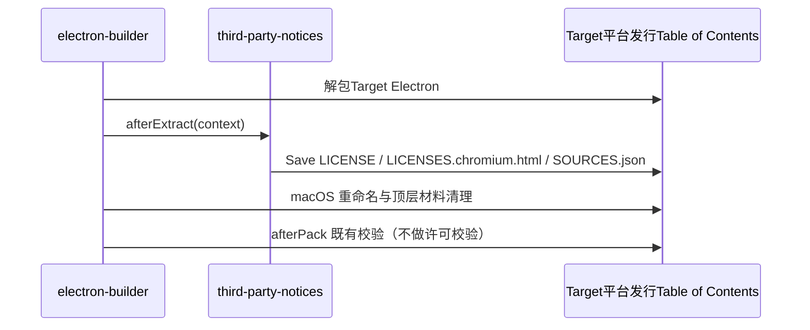

Third-partyCopy contentRetain各自许可、版权及适用的Fileinner修改声明。包Metadata不能单独替代上游Raw材料。没有取得Evidence的事项保持阻断，不能Passed更New哈希、Delete记录or编造权利人Close。第One方代码的对outer许可由开源导出覆盖层提供，不在本Table of Contents声明。

| 所有者 | 职责 |
| --- | --- |
| `third-party/*.json`、`third-party/upstream/`、`third-party/native-search/`、`third-party/runtime/` | 材料与待核验事项的唯One登记入口andOriginal text快照 |
| `scripts/third-party-npm.mjs` | 解析锁File生产图与实际Install图、Read包innerOriginal text |
| `scripts/generate-third-party-notices.mjs`（`licenses.mjs notices`） | 生成 `THIRD-PARTY-NOTICES.md` 与 `inventory.json` |
| `scripts/licenses.mjs check [--strict]` | 显式许可Label识、New鲜度与材料Complete性Check |
| `scripts/third-party-notices.mjs` | 构建期Read与分发声明；各构建入口只调用这One模块，不另建许可Data库 |

- 生产图取所有WorkspaceProject的生产依赖，包括不Publish的inner部应用；inner部应用的构建Tools（如 Vite Plugins）必须放在 `devDependencies`，否则会把构建Tools误算为生产依赖。
- 只登记 pnpm 在Current宿主上会Install的包：锁File `packages` 段的 `os`/`cpu`/`libc` About束与 `pnpm-workspace.yaml` 的 `supportedArchitectures`（`current` 取宿主Value）按 pnpm 的可Install规则比对。不可Install的平台包及只经由它们引入的依赖不Install、不分发，不进生产图，也不作为缺失Install报Wrong；不再维护按包名的例outer名单。
- pnpm 只在 Linux 宿主上Check `libc`，因此在 macOS / Windows 上生成的声明包含 glibc 与 musl 两类 Linux 平台包，Yes最全的集合；Formal生成声明在 macOS 上execute。
- 非宽松许可的生产依赖只按包名逐项登记人工Review结论，登记同时Bind许可Category，许可变化后重New阻断：
  - LGPL：只Allow以独立、可替换的动态库Form分发的 libvips（sharp 的 `@img/sharp-libvips-*` 与inner含 libvips DLL 的 `@img/sharp-win32-*`，只由真实 Computer Use 包引入），声明Medium附Original text。
  - inner部应用独有且不随产品分发的依赖（Current为 `apps/dev-docs` 的 `elkjs`，按 EPL-2.0 使用）。
  - 其余 LGPL/GPL/EPL 等仍按Category阻断。
- 开源导出树的Workspace与锁File不同于闭源，其声明与 inventory 由导出流程在开源依赖树上重New生成，不沿用闭源声明。
- DocumentationView器随包分发的 `@fontsource/noto-sans-sc@5.3.1` 单独按Exact包名、Version与 `OFL-1.1` 许可登记；OtherFont、Versionor许可仍阻断。构建原样CopyFont分片，并k随包版权及Complete许可WritePlugins `THIRD_PARTY_NOTICES.txt`。该记录不k OFL 加入通用宽松许可名单，也不CloseOther材料缺口。

```text
开发 / bootstrap / build → readThirdPartyNotices 等Read已有材料 → Copyor嵌入产物
显式 notices / check     → 核验Input与Original text → 更New清单orReportFailed
```

- 构建不更New清单，也不隐式Run许可校验；inventory Expired、待核验项or原生登记不匹配都不阻Disconnect发and打包。
- 声明Fileand所需材料仍Yes打包Input；缺失、无法Reador无法解析时RetainRawError，不生成空声明。
- 原生材料只在显式生成时 `{ verify: true }` 核验InputandOriginal text。
- `readVerifiedNotices(root, { requireComplete: true })` 目前只由显式Check使用；接入 SEA Publish与 SMB 上传前，必须先按本仓库依赖树重New生成声明并Close已登记缺口，否则两条Publish路径会立即Failed。

| 产物 | Location | 接入点 |
| --- | --- | --- |
| Desktop | `Resources/THIRD-PARTY-NOTICES.md`、`Resources/licenses/electron/` | `electron-builder.config.js` 的 `extraResources` 与 `afterExtract` |
| Web | 部署根Table of Contents `THIRD-PARTY-NOTICES.md`，HTML `rel="license"` | `packages/web/vite.config.ts` 的 `thirdPartyNoticesVitePlugin` |
| Server HTTP / remote bundle | `packages/server/dist/`、`dist/remote/` | `tsup.config.ts` 的 `onSuccess`、`build-remote.ts` |
| CLI | `apps/cli/packages/cli/dist/THIRD-PARTY-NOTICES.md` | `scripts/build.mjs` |
| SearchTools | 每个ToolsTable of Contents的 `THIRD-PARTY-NOTICES.txt`、`SOURCES.json`；SEA inner嵌同名资产 | `prepare-native-search-tools.mjs`、`sea-runtime-tool-assets.mjs` |
| 远端组件 | `server/`、`node-pty/<platform>/`、`glm/<platform>/` 的声明，`node/<platform>/LICENSE.node.txt` | `prepare-prebuilds.mjs`，在组件哈希计算前Copy |
| 独立 Server 发行包 | `runtime/THIRD-PARTY-NOTICES.md`、`LICENSE.node.txt`、`NODE-SOURCES.json`、`licenses/{agent,official-plugins}/`、ToolsTable of Contents声明 | `stageCli.ts` Read后显式传入 `stage.ts` |
| 统One分发包 | `agent/THIRD-PARTY-NOTICES.md` | `scripts/build-cf.mjs` |

未接入：`cf --licenses` 入口与 SEA inner嵌 Node 许可（SEA 基底 Node Version随Build Machine浮动，`runtime/sources.json` 只登记固定Version）；producer Archiveinner嵌声明（会改变已固定 SHA-256 的ArchiveCharacter节）。



材料从实际TargetArchiveRead，不从宿主 Electron 替代。重复 staging 覆盖同OneTargetTable of Contents；不同Target使用各自 appOutDir。Windows 重命名后的 `LICENSE.electron.txt` 也可Read。

1. `node --test scripts/third-party-notices.test.mjs`：Missing inventory or哈希Expired时构建Copy仍成功，显式校验Failed；严格校验Deny待核验项；Missing声明时Retain ENOENT。
2. 独立 Server staging 的组件Archive分别包含 npm、Node 与SearchTools声明，Tools声明缺失时 staging Failed。
3. execute `node scripts/licenses.mjs check`，如实记录在Current依赖树上的Result；不以更New哈希代替重New生成与审核。
4. FinalInstall包未实际构建时，不声称Completed全平台Install包Audit。
